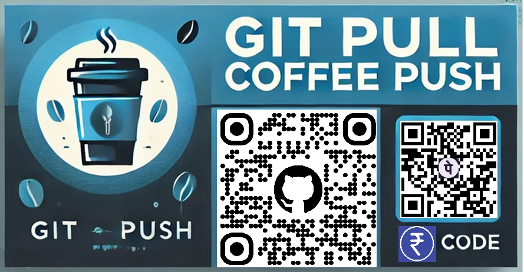

Hi, I'm Susant Achary 👋
📍 India ↔ Building Globally | 🤖 AI Systems Builder | 🚀 RecSys • GeoAI • Medical AI
Tech Stack
<table>
  <tr>
    <td valign="top" width="50%">
      <strong>Languages & App Development</strong>  
      
      
      
      
      
      
      
      
      
    </td>
    <td valign="top" width="50%">
      <strong>Databases & Data Engineering</strong>  
      
      
      
      
      
      
    </td>
  </tr>
  <tr>
    <td valign="top" width="50%">
      <strong>ML & Data Science</strong>  
      
      
      
      
      
      
      
      
    </td>
    <td valign="top" width="50%">
    <strong>Domains & AI Systems</strong>  
    
    
    
    
    
    
    
    
    
    
    
    
  </td>
  </tr>
</table>I build practical AI systems — from research and experiments to scalable pipelines, production APIs, and developer-facing applications.

Currently building in stealth_mode Port AI — secure, self-hosted, offline-ready AI across Mobile • Edge • Laptop • Raspberry Pi.
Current Projects
- 🧠 Gemma Recipes - Practical Gemma notebooks and workflows for real-world AI use cases.
- 🎯 Video Point Tracker - Local-first multimodal video point tracking with React, Express, Docker, and support for Ollama, LM Studio, and llama.cpp.
- 👗 StyleSense - Fashion recommendation system covering real e-commerce personalization scenarios.
- 🛰️ Machine Learning for Geospatial - GeoAI learning resources, experiments, and spatial machine learning references.
- 🤗 HuggingFace HandsOn Cookbook - Hands-on Hugging Face examples across text, vision, speech, and multimodal AI.
- ⚡ MLX-One - Native multimodal inference on Apple Silicon with MLX, bringing text, vision, audio, and embeddings into a unified Python library and API.
- 📚 LLM Resources, Papers, Frameworks & Tools - Curated hub of LLM papers, tools, frameworks, and implementation resources.
<!-- Mario-style banner (16:9) -->

  

Hugging Face Contributor

  
  &nbsp;&nbsp;
  

- Contributing to Hugging Face ecosystem (docs, tooling, model workflows)
- Building reproducible AI demos + practical ML systems for developers
🚧 Building: Port AI (Secure • Self-hosted • Offline)
<!-- Local AI banner -->

  

Port AI is my ongoing project to run Secure, self-hosted AI across Mobile • Edge • Laptop • Raspberry Pi:
- 🔒 Secure-by-default: local-first, privacy-first, offline-ready
- 🧠 LLM Apps: chat, RAG, tool-use/agents, eval harness
- ⚡ Optimized: quantized models, streaming, caching, lightweight deployments
- 🧰 Developer-friendly: FastAPI services, Docker profiles, reproducible configs
Repo updates: architecture, demos, benchmarks, and deployment recipes.

<!-- Tool / platform GIF row -->

  
  
  
  

🔍 What I work on
- Large Scale Recommendation Systems & NLP
- Computer Vision & Deep Learning
- Edge + Mobile
🎯 Focus Areas
🩺 Medical AI

  

- Clinical text & imaging workflows
- Decision support, triage signals, outcome prediction
🎯 Recommendation Systems

  

- Retrieval → ranking → evaluation (lift, deciles, offline/online metrics)
- Cold-start, personalization, explainability
🌍 GeoAI / Geospatial

  

- Satellite imagery analytics & spatial ML
- Location intelligence and geospatial pipelines
🔍 What I work on
- Large-scale Recommendation Systems & NLP (ranking, retrieval, personalization)
- Computer Vision & Deep Learning (feature learning, classification, detection)
- Edge + Mobile (Android occasionally, on-device/optimized inference)
- Applied AI domains: Healthcare • Education • E-Commerce • Agriculture • Supply Chain
🧰 Tech stack
Core: Python • SQL • Bash
ML: NumPy • scikit-learn • Matplotlib • (Deep Learning: Keras / PyTorch)
Data: PostgreSQL
Cloud: AWS • Azure
Tools: VS Code • Git

  
  
  
  
  
  
  

📌 Focus areas
- 🩺 Medical AI: clinical text + imaging workflows, decision support, triage signals
- 🎯 RecSys: candidate generation, learning-to-rank, cold-start, evaluation & lift
- 🌍 GeoAI: geospatial ML, satellite imagery analytics, location-based intelligence
✍️ Writing & links
- Writes on:
- LinkedIn: https://www.linkedin.com/in/curious-susant/
- 📫 Email: sache.meet@yahoo.com
⭐ Support & community
If you find my work useful, consider starring a repo — it helps a lot ❤️

Support Me, Brew Good Vibes

  

Help Keep the Ideas Open Source

  

